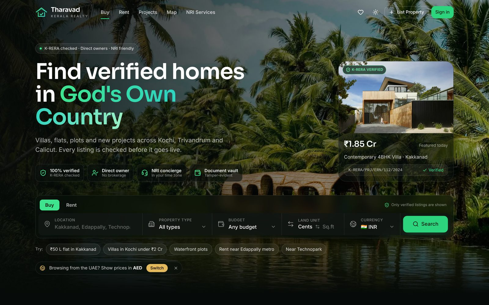
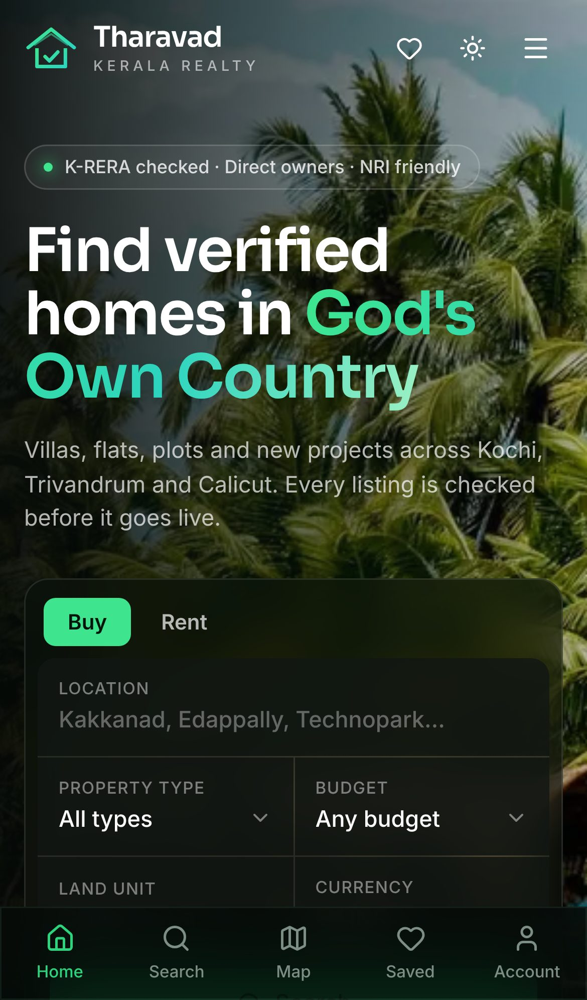

# Kerala Realty: full-stack real estate web app (demo)



"Tharavad" is a placeholder brand. Rename it in `web/src/config/site.ts`.

## Stage 1: design system and home page (done)
- Next.js 15 + Tailwind v4, dark (default) and light themes
- Hero with search (buy/rent, location, type, budget, cents ⇄ sq.ft, INR/AED/USD/QAR)
- Results flow: our recommendation (top 3 with reasons), then all matches, then follow-up questions
- Currency suggested from browser time zone (no tracking)
- Map preview, localities, NRI concierge, owner/agent call to action, mobile tab bar

## Stage 2: data (done)
- 60 listings across Kochi, Trivandrum and Kozhikode (19 hand-written + 41 generated)
- About 2,000 real places from OpenStreetMap: metro and Water Metro stops, rail, IT parks, schools, hospitals, malls, airports
- Each listing knows its nearest places, school and hospital counts, and demo flood risk
- Follow-up questions use these facts ("Only homes within 1 km of a metro", "Hide flood-prone pockets", "Compare Kakkanad with Edappally")
- Price grid for the heatmap. See [`data/README.md`](data/README.md)

## Stage 3: interactive map (done)
`/map`: MapLibre GL + deck.gl on OpenFreeMap tiles (free, no API key), restyled dark and light.

- Layers you can toggle: price heat (2D heatmap, or 3D hex columns that shrink as you zoom in), listing density, metro lines with animated light pulses (Pink Line marked under construction, approximate route), Water Metro, IT parks, hospitals, schools, demo flood zones
- Price pills for every listing; they collapse to dots when zoomed out
- Select a home: 1/2/3 km rings and 3D arcs to the nearest metro, IT park, hospital and Water Metro, with distances
- Draw a search area on the map to filter homes inside it
- Kochi, Trivandrum and Kozhikode camera presets; side list of homes in view with buy/rent, type and budget filters
- Mobile: flat 2D map, bottom sheet list, layers behind a button
- Every card's locality links to `/map?listing=<id>`


## Stage 4: accounts, roles and consent (done)
New `api/` service: Node + Express + MongoDB (Mongoose), TypeScript.

- **Six roles with RBAC from day one:** guest, buyer, NRI buyer, owner, agent/builder, admin. Every API route checks a permission (`api/src/auth/rbac.ts`); the UI only hides buttons.
- **Sign in / register** (`/signin`) with a role picker. Owners and agents start in "verification pending". Homes saved while signed out move into the account.
- **Sessions:** signed JWT in an http-only, SameSite=Lax cookie. The web app proxies `/api/*` to the API, so the cookie is first-party. Writes must be JSON (CSRF guard). Login is rate limited and gives the same error for unknown email and wrong password.
- **Buyers:** saved homes synced to the account, visit and live-video-tour booking (9 AM to 8 PM IST, shown in IST and your own time zone), cancel visits.
- **NRI dashboard:** advisor + WhatsApp, two clocks, currency and time zone preferences, shortlist priced in INR/AED/USD/QAR, visits in both time zones, concierge requests.
- **Owners/agents:** their own listings with visit-request counts (adding and editing comes with the owner portal).
- **Admin:** users and the audit trail.
- **DPDP consent banner:** allow all, essential only, or customise; nothing optional runs before a choice. Stored locally and recorded by the API with a random id (no IP). "Privacy choices" in the footer reopens it; `/privacy` has the notice.
- **Audit trail** of sign-ins, failed logins, registrations, bookings and concierge requests.
- 18 API tests (`cd api && npm test`) run against a real temporary MongoDB.

## Run locally

Two terminals:

```bash
cd api && npm install && npm run dev      # http://localhost:4000, in-memory MongoDB, demo data seeded
```

```bash
cd web && npm install && npm run dev      # http://localhost:3000
```

Demo accounts (local only) are on the sign-in page: buyer, NRI, owner, agent and admin `@example.com`, password `demo-pass-2026`.

| Variable | Where | What |
|---|---|---|
| `API_URL` | web | API base URL for the `/api` proxy (default `http://localhost:4000`) |
| `NEXT_PUBLIC_SHOW_DEMO_ACCOUNTS` | web | `false` hides the demo-account buttons |
| `MONGODB_URI` | api | MongoDB Atlas connection string (empty locally = in-memory) |
| `JWT_SECRET` | api | long random string; required in production |
| `SEED_DEMO_USERS` | api | `true` seeds demo accounts in production |

Listings and places are generated data (see [`data/README.md`](data/README.md)). Photos come from Unsplash (free licence) and are stored in `web/public/img`.

## Screenshots

| Search flow | Mobile |
|---|---|
|  |  |

More in `docs/screenshots/`.
