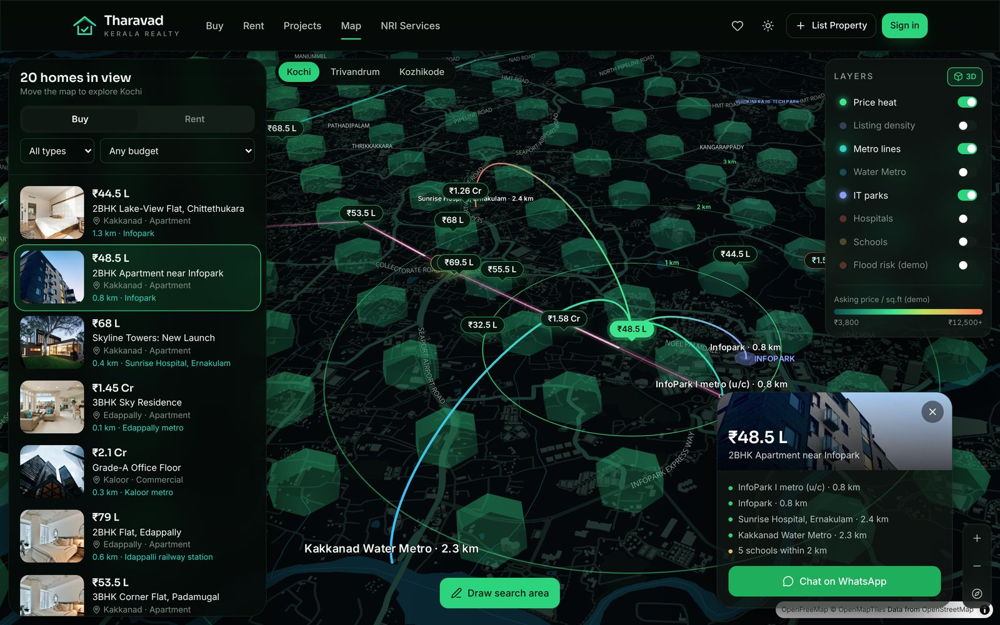
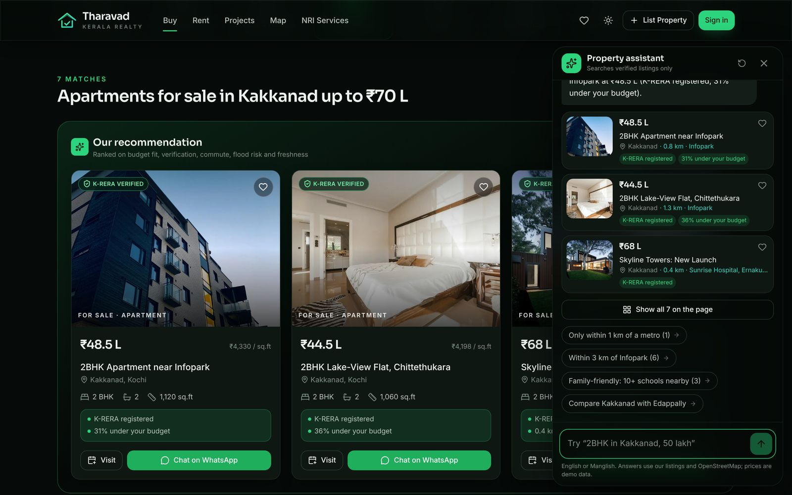
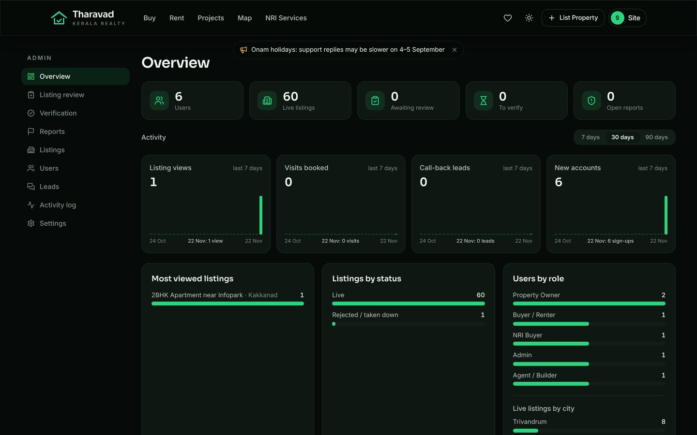
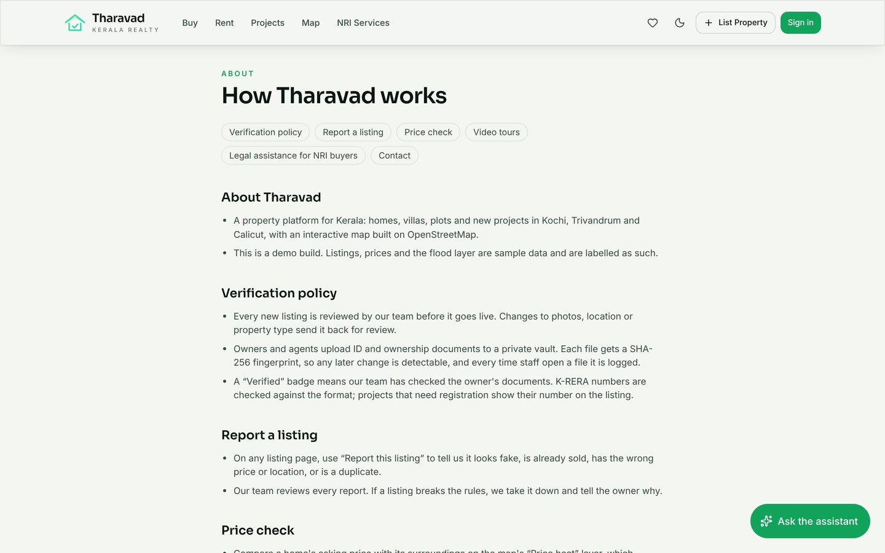
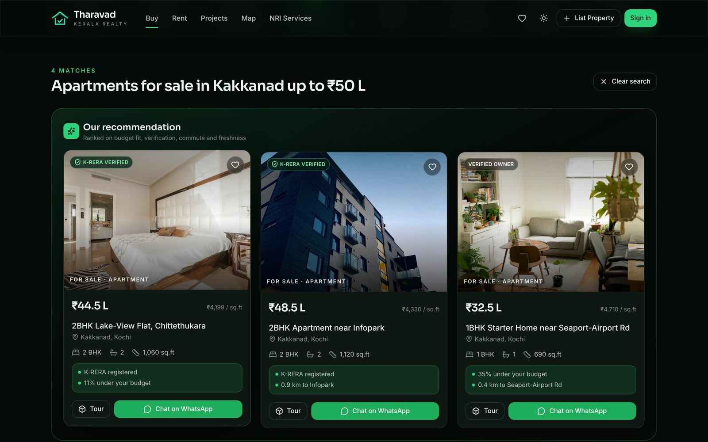
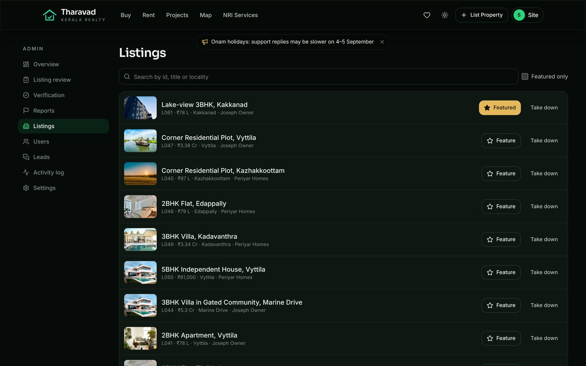
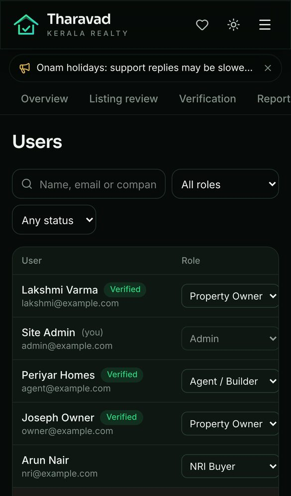

# Kerala Realty: full-stack real estate web app (demo)


"Tharavad" is a placeholder brand. Rename it in `web/src/config/site.ts`.

## Stage 1: design system and home page (done)
- Next.js 15 + Tailwind v4, dark (default) and light themes
- Hero with search (buy/rent, location, type, budget, cents ⇄ sq.ft, INR/AED/USD/QAR)
- Results flow: our recommendation (top 3 with reasons), then all matches, then follow-up questions
- Currency suggested from browser time zone (no tracking)
- Map preview, localities, NRI concierge, owner/agent call to action, mobile tab bar

## Stage 2: data (done)
- 60 listings across Kochi, Trivandrum and Kozhikode (19 hand-written + 41 generated)
- About 2,000 real places from OpenStreetMap: metro and Water Metro stops, rail, IT parks, schools, hospitals, malls, airports
- Each listing knows its nearest places, school and hospital counts, and demo flood risk
- Follow-up questions use these facts ("Only homes within 1 km of a metro", "Hide flood-prone pockets", "Compare Kakkanad with Edappally")
- Price grid for the heatmap. See [`data/README.md`](data/README.md)

## Stage 3: interactive map (done)
`/map`: MapLibre GL + deck.gl on OpenFreeMap tiles (free, no API key), restyled dark and light.

- Layers you can toggle: price heat (2D heatmap, or 3D hex columns that shrink as you zoom in), listing density, metro lines with animated light pulses (Pink Line marked under construction, approximate route), Water Metro, IT parks, hospitals, schools, demo flood zones
- Price pills for every listing; they collapse to dots when zoomed out
- Select a home: 1/2/3 km rings and 3D arcs to the nearest metro, IT park, hospital and Water Metro, with distances
- Draw a search area on the map to filter homes inside it
- Kochi, Trivandrum and Kozhikode camera presets; side list of homes in view with buy/rent, type and budget filters
- Mobile: flat 2D map, bottom sheet list, layers behind a button
- Every card's locality links to `/map?listing=<id>`



## Stage 4: accounts, roles and consent (done)
New `api/` service: Node + Express + MongoDB (Mongoose), TypeScript.

- **Six roles with RBAC from day one:** guest, buyer, NRI buyer, owner, agent/builder, admin. Every API route checks a permission (`api/src/auth/rbac.ts`); the UI only hides buttons.
- **Sign in / register** (`/signin`) with a role picker. Owners and agents start in "verification pending". Homes saved while signed out move into the account.
- **Sessions:** signed JWT in an http-only, SameSite=Lax cookie. The web app proxies `/api/*` to the API, so the cookie is first-party. Writes must be JSON (CSRF guard). Login is rate limited and gives the same error for unknown email and wrong password.
- **Buyers:** saved homes synced to the account, visit and live-video-tour booking (9 AM to 8 PM IST, shown in IST and your own time zone), cancel visits.
- **NRI dashboard:** advisor + WhatsApp, two clocks, currency and time zone preferences, shortlist priced in INR/AED/USD/QAR, visits in both time zones, concierge requests.
- **Owners/agents:** their own listings with visit-request counts (adding and editing comes with the owner portal).
- **Admin:** users and the audit trail.
- **DPDP consent banner:** allow all, essential only, or customise; nothing optional runs before a choice. Stored locally and recorded by the API with a random id (no IP). "Privacy choices" in the footer reopens it; `/privacy` has the notice.
- **Audit trail** of sign-ins, failed logins, registrations, bookings and concierge requests.
- 18 API tests (`cd api && npm test`) run against a real temporary MongoDB.

## Stage 5: AI assistant (done)
A chat assistant on every page (side panel on tablet/desktop, bottom sheet on phones) that searches verified listings and drives the home page: **our recommendation → all matching listings → next questions**.

How it stays within free API limits:

| Step | What happens | AI cost |
|---|---|---|
| 1. Rules | English + Manglish parser (`api/src/ai/parse.ts`): place, budget, BHK, type, buy/rent, metro, flood, schools, hospital, compare, call-back | free |
| 2. Structured output | Unclear searches go to Gemini with a JSON schema; the result is validated with Zod before use | 1 call |
| 3. RAG | Hard filters + 2.5 km radius in MongoDB, then ranking by budget fit, K-RERA, commute, flood risk and Gemini embeddings of each listing | embeddings once per listing |
| 4. Agent | Open questions ("is this villa fairly priced?") run a tool-calling loop over our data: `search_listings`, `find_listing`, `listing_details` (with price check), `compare_localities`, `offer_callback`; max 4 steps | 1–4 calls |
| 5. Guard rails | 24 h answer cache, 15 AI answers per visitor per day, 800 per day site-wide, retry then fall back across models (and optional Groq/OpenRouter keys); if all fail, rules still answer | – |

- **Personalised, with consent:** with "personalisation" allowed, device, time zone and currency shape the suggestions (NRI time zones get video-tour and advisor prompts); with "location" allowed, the city comes from Vercel's edge headers (`web/src/app/api/geo`), no third-party lookup. A suggestion such as "Looking for a ₹70 lakh flat in Kakkanad?" (the city's median flat price) appears a few seconds after landing.
- **Lead capture:** call-back form in the chat with explicit consent; leads show for the listing's owner/agent and for admins.
- **Evals:** 30 English/Manglish cases in `api/evals/cases.json`. `npm run eval` scores the rules (free); `npm run eval -- --llm` scores Gemini's structured output. Latest: rules 30/30, Gemini 29/30 (the miss was a provider outage). Reports in `api/evals/`.
- **Monitoring:** every turn logs mode, intent, latency, tokens, tools and errors (no message text). Admins see it on their dashboard.

Set `GEMINI_API_KEY` on the API host to turn the AI on; without it the assistant runs on rules only. See `api/.env.example` for the optional fallback keys and limits.



## Stage 6: owner and agent portal (done)
- `/portal`: listings with views, saves, visits and leads; visit requests (confirm, decline, mark done; buyer contact shared only after confirming); enquiries; document vault and profile verification uploads.
- Six-step listing editor: basics, location (map pin; nearby places and flood risk computed on save), details (price, area, amenities, K-RERA with format check, new-project fields for agents), photos (resized in the browser to WebP, reorder, cover) and video link, private documents (SHA-256 fingerprint, every view audited), review.
- Lifecycle: draft → in review → live → sold / rented / paused. Price, description, video and amenity edits stay live; photo, location and type changes go back to review. Admins approve or send back from the admin console (stage 7).
- Public listing page `/listings/[id]` (server-rendered from the API) and the whole site now reads live listings from the API, so new homes appear in search, the map and the assistant.
- Files are stored in MongoDB GridFS (no extra service), with a per-account cap (`UPLOAD_MAX_FILES`, default 80; `UPLOAD_MAX_MB`, default 60) so the free 512 MB database can't be filled by one account. 53 API tests.

## Stage 7: admin console (done)
- `/admin` (admin role only; every route checks an admin permission on the server):
  - **Overview:** headline numbers, then daily views, visits, leads and sign-ups (7, 30 or 90 days), most-viewed listings, and listings by status and city.
  - **Listing review:** approve, or send back with a note the owner sees.
  - **Verification:** owner and agent ID documents, opened through the audited vault. Verifying an owner gives all their listings the verified badge.
  - **Reports:** visitors flag fake, sold or wrong listings (one open report per visitor); the admin dismisses or takes down, which closes every report on that listing.
  - **Listings:** search, feature (featured homes come first on the home page) or take down with a reason.
  - **Users:** search and filter, change role, suspend or reactivate, set verification.
  - **Leads**, **Activity log** (filter by action and role) and **Settings**.
- Role changes and suspensions apply at once: sessions are re-checked against the database (cached 30 s per process), and a change signs the person out. Suspended accounts can't sign in.
- Settings are stored in the database and apply within 30 seconds without a redeploy:
  - a site-wide announcement;
  - AI on/off and daily limits;
  - per-account upload caps.
  The env variables below are now only the defaults. 64 API tests.



## Stage 8: launch readiness (done)
- **Deploy on free tiers:** Vercel (web), Render (API, [`render.yaml`](render.yaml)) and MongoDB Atlas M0. Step by step in [docs/DEPLOY.md](docs/DEPLOY.md).
- **Trusted proxy:** the website's middleware adds a shared `PROXY_SECRET` and the visitor's IP to every `/api` call. The API refuses calls without it, and rate limits count visitors rather than Vercel's servers.
- **Safe accounts in production:** the demo admin (public password) is never created in production; the first admin comes from `ADMIN_EMAIL` and `ADMIN_PASSWORD`. Demo accounts are off unless switched on, because they would expose real visitors' enquiries.
- **Cold starts:** listing pages wait at most 8 s for a sleeping API, then fall back to the demo data or a "try again" page. An optional GitHub Action keeps the API awake. `/health` reports database status, and the API shuts down cleanly on deploys.
- **Grounding eval** (`npm run eval:grounding`): runs the real assistant and checks that every card, rupee amount, distance, growth figure and count it states matches the database or locality data. Rules: 20/20; with Gemini: 20/20.
- **CI** on every push: typecheck, tests, both evals, lint and build.
- **Web:** security headers with a Content Security Policy, sitemap, robots rules, share previews, schema.org data on listings, 404 and error pages, and an About page.
  - Footer and navbar links now open real filtered results (`/?purpose=rent`, `/?type=plot`).
  - WhatsApp buttons appear only once `NEXT_PUBLIC_WHATSAPP_NUMBER` is set.
  - The privacy notice now says what the AI provider receives.
- **Fixes:** listing pages were wider than phone screens (long place names), and the NRI page showed an invented advisor name; it now shows the NRI desk. 69 API tests.



## Run locally

Two terminals:

```bash
cd api && npm install && npm run dev      # http://localhost:4000, in-memory MongoDB, demo data seeded
```

```bash
cd web && npm install && npm run dev      # http://localhost:3000
```

Demo accounts (local only) are on the sign-in page: buyer, NRI, owner, agent and admin `@example.com`, password `demo-pass-2026`.

| Variable | Where | What |
|---|---|---|
| `API_URL` | web | API base URL for the `/api` proxy (default `http://localhost:4000`) |
| `NEXT_PUBLIC_SHOW_DEMO_ACCOUNTS` | web | demo sign-in buttons in production builds: `true` (no admin) or empty (hidden); always shown in `npm run dev` |
| `NEXT_PUBLIC_WHATSAPP_NUMBER` | web | WhatsApp number, digits with country code; buttons hidden while empty |
| `NEXT_PUBLIC_SITE_URL` | web | public address for the sitemap and share previews (Vercel's URL by default) |
| `PROXY_SECRET` | web + api | same value on both; the API then only answers the website's proxy |
| `MONGODB_URI` | api | MongoDB Atlas connection string (empty locally = in-memory) |
| `JWT_SECRET` | api | long random string; required in production |
| `SEED_DEMO_USERS` | api | `true` seeds the demo buyer, NRI, owner and agent in production (never the admin) |
| `ADMIN_EMAIL`, `ADMIN_PASSWORD` | api | first admin account, created once on start (password 12+ characters) |
| `GEMINI_API_KEY` | api | turns on the AI assistant (free tier works) |
| `GROQ_API_KEY`, `OPENROUTER_API_KEY` | api | optional free fallbacks when Gemini is busy |
| `AI_DAILY_LIMIT`, `AI_GLOBAL_DAILY_LIMIT` | api | default AI answers per visitor / per day (15 / 800); admins can change them in Settings |
| `UPLOAD_MAX_FILES`, `UPLOAD_MAX_MB` | api | default per-account storage cap (80 files / 60 MB); admins can change it in Settings |

Listings and places are generated data (see [`data/README.md`](data/README.md)). Photos come from Unsplash (free licence) and are stored in `web/public/img`.

## Screenshots

| Search flow | Mobile |
|---|---|
|  |  |
|  |  |

More in `docs/screenshots/`.
